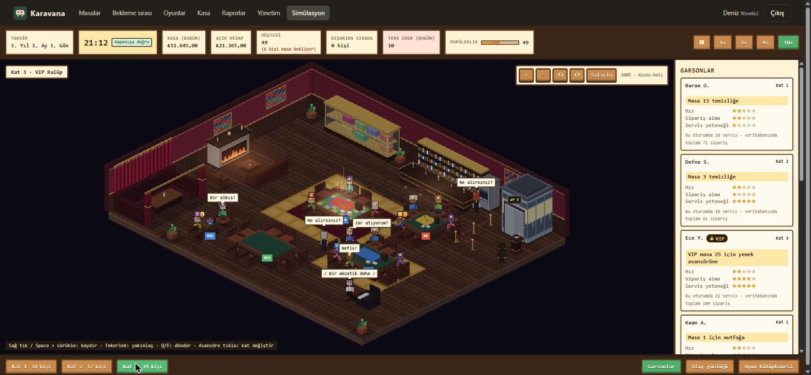

# Karavana – Kutu Oyunu Cafe İşletme Sistemi

Veritabanı dersi dönem projesi (Enes Öztürk, Emre Alma). **Seçilen DB: PostgreSQL.**

Masalar, kutu oyunu kopyaları ve bekleme sırası, menü ve stok, sipariş, hesap ve nakit/kart ödeme,
personel ve rol bazlı yetki. İş kuralları veritabanında (kısıt, tetikleyici, prosedür); API ince, ön yüz React.

## Hızlı başlangıç (kurulum gerektirmez)
Node.js 20+ yeterli. Veritabanı olarak gömülü PostgreSQL (PGlite) kullanılır.
```bash
npm install
npm run build -w app/web      # ön yüzü derle
npm run api:lite              # http://localhost:3001  (veri db/.pglite içinde kalır)
```
Tarayıcıda `http://localhost:3001` → örnek personel: `yonetici`, `kasiyer`, `garson` (parola `06_seed.sql` içinde).

## Gerçek PostgreSQL ile
1. PostgreSQL 18 kurun (Windows: `winget install PostgreSQL.PostgreSQL.18`, Mac: `brew install postgresql@18`)
   **veya** Docker: `make up DB=postgres` (port 5433, `postgres:18` imajı).
   > Docker'da daha önce **PostgreSQL 15** imajıyla kurulmuş bir volume varsa 18 onu açamaz: önce `make reset`,
   > sonra `make up DB=postgres` çalıştırın (eski Docker verisi silinir; örnek veri init betikleriyle yeniden kurulur).
2. `.env.example` → `.env` kopyalayın. Yerel kurulumda `POSTGRES_PORT=5432`, `PG_ADMIN_USER=postgres`,
   `PG_ADMIN_PASSWORD=<kurulumda verdiğiniz parola>`.
3. Kurun ve test edin:
   ```bash
   npm install
   npm run db:kur        # geliştirme veritabanını (karavana) sıfırdan kurar: init betikleri + örnek veri
   npm test              # 62 veritabanı + 12 API testi (ayrı karavana_test veritabanında)
   npm run api           # API (5173'teki ön yüz için)
   npm run dev -w app/web   # ön yüz geliştirme sunucusu: http://localhost:5173
   ```

## Ekran görüntüleri
[`docs/ekran/`](docs/ekran/README.md): masa panosu, VIP oyun reddi (veritabanı tetikleyicisi), raporlar ve simülasyonun üç katı.



## Komutlar
| Komut | Ne yapar |
|---|---|
| `npm run db:kur` | **Geliştirme verisini sıfırlar:** `POSTGRES_DB`'yi (karavana) silip `db/postgres/init/*.sql` ile yeniden kurar; simülasyon verisi gider |
| `npm run db:goc` | Geliştirme verisini silmeden eklemeli migration'ları (07 ve sonrası) uygular |
| `npm run db:test` / `db:test:lite` | Veritabanı testleri (PostgreSQL'de ayrı `POSTGRES_TEST_DB` = karavana_test, her testte sıfırdan / PGlite bellekte); geliştirme verisine dokunmaz |
| `npm test` / `test:lite` | Tüm testler |
| `npm run db:performans` | 100k oturumluk veriyle index ölçümü → `docs/PERFORMANS.md` |
| `npm run db:yetki` | Her rolle yetki/maskeleme denemesi → `docs/YETKI.md` |
| `npm run api` / `api:lite` | API sunucusu (derlenmiş ön yüzü de verir) |

## Yapı
```
db/postgres/init/   01 şema · 02 fonksiyon/tetikleyici · 03 view · 04 prosedür · 05 güvenlik · 06 örnek veri
db/lib/             ortak bağlantı katmanı (pg veya PGlite)
db/scripts/         kurulum, performans ve yetki kanıtı betikleri
db/tests/           veritabanı testleri
app/api/            Express API
app/web/            React + Vite ön yüz
docs/               mimari, API, ER, normalizasyon, performans, yetki, sunum, yol haritası
```

## Dokümanlar
- [Mimari](docs/ARCHITECTURE.md) · [ER diyagramı](docs/ER.md) · [Normalizasyon](docs/NORMALIZASYON.md)
- [API](docs/API.md) · [Performans](docs/PERFORMANS.md) · [Yetki ve maskeleme](docs/YETKI.md)
- [Yol haritası ve puan kriterleri](docs/ROADMAP.md) · [Sunum içeriği](docs/SUNUM.md) · [Simülasyon](docs/SIMULASYON.md)

Teslim: 27 Aralık 2026 23:59; sunumda herkese açık GitHub linki paylaşılır.
