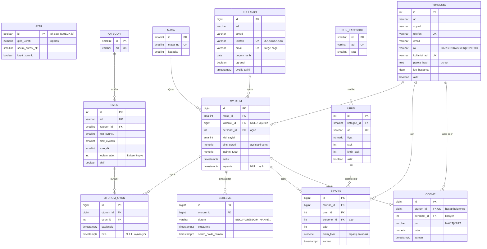

# ER diyagramı

GitHub bu diyagramı otomatik çizer (Mermaid). Sunum için görsel: GitHub'da dosyayı açıp diyagramı
dışa aktarın veya <https://mermaid.live> üzerine yapıştırın.

## İlişkiler
| İlişki | Kardinalite | Not |
|---|---|---|
| masa – oturum | 1 : N | Aynı anda en fazla 1 açık oturum (kısmi UNIQUE `uq_oturum_masa_acik`) |
| kullanici – oturum | 0..1 : N | Kayıt zorunluysa prosedür boş geçmeye izin vermez (`ayar.kayit_zorunlu`) |
| oturum – oyun | N : M (`oturum_oyun`) | Bir oturumda aynı anda tek aktif oyun (`uq_oturum_oyun_aktif`) |
| oturum – urun | N : M (`siparis`) | Fiyat sipariş anında kopyalanır (tarihsel doğruluk) |
| oturum – bekleme | 1 : N | Kuyrukta aynı anda tek aktif kayıt; tüm sistemde tek seçim hakkı |
| oturum – odeme | 1 : 0..1 | `uq_odeme_oturum`; hesap bölünmez |
| personel – oturum/siparis/odeme | 1 : N | İşlemi yapan personel `fn_aktif_personel()` ile yazılır |
